  
  
  
  
  
  

### Hi, I'm Alamin 👋

I design and build websites that bring in customers, then protect them, and the people behind them, from cyber threats.

I'm a website designer, developer and cyber security specialist from Dhaka, Bangladesh, working with businesses, nonprofits and individuals worldwide since 2020. I also worked as a Technical Support Engineer at Hostinger, helping website owners through migrations, performance problems and malware cleanups.

**600+ projects delivered · 4.9★ average rating · 6+ years of experience**

> 🟢 **Open for new projects.** Tell me what you need on [WhatsApp](https://wa.me/8801521432405) or through my [contact page](https://thealamin.com/contact.html).

---

### What I can do for you

<table>
<tr>
<th width="50%" align="left">🌐 Web Design &amp; Development</th>
<th width="50%" align="left">🛡️ Cyber Security</th>
</tr>
<tr>
<td valign="top">

- Custom websites designed and coded around your brand
- Online stores with secure payments and smooth checkout
- Web apps, client portals and dashboards
- Business websites and landing pages that convert
- UI/UX design, wireframes and prototypes
- Redesigns, speed optimization and maintenance

[See web services →](https://thealamin.com/service.html)

</td>
<td valign="top">

- Security audits and risk assessments
- Vulnerability assessment and penetration testing
- Hacked website recovery and malware removal
- Email security: SPF, DKIM, DMARC and anti-phishing
- Network, cloud and device hardening
- Security awareness training for your team

[See security services →](https://thealamin.com/security.html)

</td>
</tr>
</table>

Not sure how safe your business is? Take the free [2-minute Security Health Check](https://thealamin.com/security.html#health-check).

### Recent client work

| Project | What I built |
| --- | --- |
| [**Tangelic**](https://www.tangeliclife.org/) | Website for a US climate nonprofit bringing clean energy to communities in Africa |
| [**Shop Zen Designs**](https://www.shopzendesigns.com/) | Online store for handcrafted baskets, home décor and gifts |
| [**Jill Riley World**](https://jillriley.world/) | Personal travel brand and blog covering 54+ countries |
| [**Vibrant Truth**](https://vibranttruth.com/) | Brand website and online store for a relationship card game |

More case studies in my [portfolio →](https://thealamin.com/portfolio.html)

### Open-source projects

- [**woodcalculator**](https://github.com/thealamin/woodcalculator): an offline Bengali calculator for round-log wood volume and price, built as an installable web app for a non-technical user. [Try it live →](https://thealamin.com/calculator/)
- [**Disease-prediction-system**](https://github.com/thealamin/Disease-prediction-system): a symptom checker with a machine-learning model, a FastAPI backend and a Bengali interface that also suggests which doctor to see.
- [**movie-explorer**](https://github.com/thealamin/movie-explorer): a responsive React and Tailwind app for browsing and searching TV shows, with live search and detail pop-ups. [Try it live →](https://thealamin.github.io/movie-explorer/)

### How I work

1. **Tell me about your project.** Share your goals on WhatsApp or the contact form. I'll ask a few questions to understand what you need.
2. **Get a clear plan and quote.** You get the scope, timeline and price in writing before any work starts.
3. **Design and build.** I design and develop your site and share progress, so you can give feedback along the way.
4. **Secure and launch.** Your site goes live hardened, backed up and optimized, and I show you how to manage it.

### Tools and areas I work with

**Web:** HTML &amp; CSS · JavaScript · PHP · Python · WordPress · WooCommerce · Shopify · UI/UX Design 
**Security:** OWASP Top 10 · Firewall &amp; 2FA · Microsoft 365 / Google Workspace · Backups &amp; Recovery · ISO 27001 / NIST

### Latest from my blog

- [7 Signs Your Website Has Been Hacked (and What to Do First)](https://thealamin.com/blog-website-hacked-signs.html)
- [Small Business Cyber Security Checklist](https://thealamin.com/blog-small-business-security-checklist.html)
- [Why Your Website Is Slow (and How to Fix It)](https://thealamin.com/blog-why-website-slow.html)
- [Before You Hire a Web Designer: 9 Questions to Ask](https://thealamin.com/blog-before-you-hire-a-web-designer.html)

---

  <b>Have a project in mind, or worried about your security?</b> 
  <a href="https://thealamin.com/contact.html">Start a conversation →</a> · <a href="https://wa.me/8801521432405">WhatsApp</a> · <a href="mailto:thealamin24@gmail.com">thealamin24@gmail.com</a>

